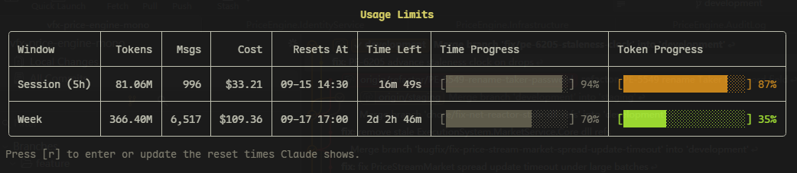

# AIUsageMonitor

[](https://github.com/coldhighsun/AIUsageMonitor/actions/workflows/ci.yml)
[](https://codecov.io/gh/coldhighsun/AIUsageMonitor)
[](https://dotnet.microsoft.com/)
[](#项目结构)
[](LICENSE)
[](https://github.com/coldhighsun/AIUsageMonitor/releases/latest)
[](https://github.com/coldhighsun/AIUsageMonitor/releases)
[](https://www.nuget.org/packages/AIUsageMonitor.Cli)
[](https://www.nuget.org/packages/AIUsageMonitor.Cli/absoluteLatest)
[](https://www.nuget.org/packages/AIUsageMonitor.Cli)
[](https://github.com/coldhighsun/AIUsageMonitor/commits/main)

[English](README.md) | 中文

---

一个基于 Claude Code 本地使用数据的**只读**分析工具。它从不调用 Anthropic API，只读取 Claude Code 自身已经写入 `~/.claude` 目录下的文件(`stats-cache.json`、`history.jsonl`、`projects/*.jsonl` 会话记录),并将其转换为按天/按周期/按模型/按小时/按会话的用量报告与成本估算。

## 项目结构

- **AIUsageMonitor.Core** — 数据解析与分析引擎所在的类库,不依赖 Cli/WPF。
- **AIUsageMonitor.Cli** — 控制台程序(命令名 `aimon`),以命令行方式输出用量报告。
- **AIUsageMonitor.WPF** — Windows 桌面仪表盘(WPF,仅支持 Windows)。

## 安装

通过 [winget](https://learn.microsoft.com/en-us/windows/package-manager/winget/) 安装:

```
winget install coldhighsun.AIUsageMonitor.Cli
```

或通过 [dotnet tool](https://learn.microsoft.com/en-us/dotnet/core/tools/global-tools-how-to-use) 安装(跨平台):

```
dotnet tool install --global AIUsageMonitor.Cli
```

或从源码构建:

```
dotnet build AIUsageMonitor.slnx
```

## CLI 用法

```
aimon <命令>
```

(或从源码运行:`dotnet run --project src/AIUsageMonitor.Cli -- <命令>`)

> 💡 **优先使用 `aimon watch`** —— 这是日常使用本工具的推荐方式:实时展示当前会话和每周额度的用量情况,让你随时掌握剩余空间。

可用命令:

- `watch` — **(推荐)** 实时刷新视图(`limits|today|week|models|sessions|hours`,默认为 `limits`),按指定间隔自动刷新
- `today` — 今日用量
- `week` — 本周用量
- `month` — 本月用量
- `models` — 按模型统计用量
- `sessions` — 会话整体统计;加 `--list` 则列出每个会话
- `projects` — 按项目统计用量
- `hours` — 按小时统计用量
- `export` — 导出原始分析数据;支持 `--format json|csv` 与 `--output <path>`(默认输出到标准输出,格式为 JSON)

报表选项(`today`、`week`、`month`、`models`、`hours`、`sessions`):

- `--json` — 以 JSON 输出(不显示进度条和表格,并跳过更新检查),便于脚本处理
- `today --date yyyy-MM-dd` — 查看指定某天
- `week` / `month`:`--from yyyy-MM-dd [--to yyyy-MM-dd]` 或 `--last <天数>`;`month` 另支持 `--month yyyy-MM`。范围最长 3650 天,年份限定在 2000–2999;值无效时向 stderr 输出错误并以退出码 1 结束
- `models --model <文本>` — 只显示名称包含该文本的模型(占比仍相对于全部模型)。若没有匹配项,表格模式会向 stderr 输出 `No model matches '<文本>'.` 并以退出码 0 结束,`--json` 则输出 `[]`

按项目、按会话统计(`projects`、`sessions --list`):

- 范围:`--from`/`--to`、`--last`、`--month` 同上,默认**最近 30 天**
- `--top <n>` — 只显示前 N 行;`--sort` — `projects`:`tokens|cost|sessions|messages`,`sessions --list`:`tokens|cost|messages|duration|start`(从大到小,`start` 为最新在前,默认 `tokens`);按 `messages` 排序时表格会增加 Messages 列
- `--project <文本>` — 只看工作目录或 `projects/` 文件夹名包含该文本的项目;`--model <文本>` — 只统计名称匹配的模型(会话中只计入这些助手消息)
- `--json` 会输出 `totalProjects` / `totalSessions`(应用 `--top` 之前的匹配数)和各行数据,时长字段为 `durationSeconds`
- 不带 `--list` 的 `sessions` 行为不变;不带 `--list` 却给了范围、`--top`、`--sort`、`--project` 或 `--model` 会报错
- 会话会被范围裁剪(只显示范围内发生的部分),可能跨多个转录文件;`messages` 统计转录行数,`duration` 是首尾消息之间的墙钟时间(含空闲)。同一天范围内 token 与 `month` 一致;这里的费用按每条消息精确计价(含 5 分钟/1 小时缓存写入),所以和 `month`(按全期模型比例缩放估算)略有出入,且 `month` 会把跨天会话在每个活跃日各算一次

`watch` 的默认视图 `limits` 近似展示 Claude 官方账户界面中的 "Current Session"(滚动 5 小时窗口)和 "This Week" 面板,各自附带 **Time Progress**(窗口已过去的时间比例,当 token 消耗明显落后/领先于时间进度时会分别显示绿色/橙色)与 **Token Progress**(用量占预算的比例)两条进度条。针对当前会话窗口,当 token 消耗进度明显快于或慢于时间进度时,表格下方还会出现一条节奏提示,建议你放慢或可以放心多用。

真实的重置时间和 token 上限存储在 Anthropic 账号侧,本地无法读取,建议各录入一次:

- `--session-reset "HH:mm"` — Claude 显示的会话重置时间(如 `"18:30"`)
- `--week-reset "Ddd HH:mm"` — 每周重置时刻(如 `"Mon 09:00"`);账号固定不变,只需录入一次,不会像会话那样过期
- `--session-token-progress <百分比>` / `--week-token-progress <百分比>` — Claude 显示的用量百分比(如 `32`),用来反推出用量预算。百分比会连同当时统计到的成本一起保存,预算由它推算;窗口内还没有统计到用量时给出的百分比会被忽略(保留已保存的)
- `--cache-read-weight <0-1>` — cache read token 按标价的多大比例计入用量进度条(默认 `0.1`,是经验值:订阅额度不按 API 标价计量,而 cache read 在长会话里占绝大多数)。进度条比 Claude 显示的快就调小,慢就调大;已保存的百分比会保留并按新权重重新推算预算,无需再看 `/usage`。传入后会被保存,`--reset-cache-read-weight` 可忘记它。表格下方有一行说明进度条由哪几类 token 构成(cache read / output / cache write / input)

不配置这些参数时,会根据本地会话记录估算;当本地证据不足时(近 5 小时无活动,或压根没有周期锚点),对应行会显示为**未知**,而不是编造一个倒计时。

在 `watch` 运行中按 `r` 可随时重新录入以上四项(直接回车保留当前值)。在交互式终端中,未配置的项会一次性提示输入,并保存到 `%LOCALAPPDATA%/aimon/limits-settings.json`(或对应系统的等效路径)供后续运行复用。



## 更新检查

每个命令执行结束后都会检查一次 GitHub 上是否有新版本发布(`watch` 会在进入刷新循环前检查一次,并在整个运行期间将提示固定显示在视图底部)。带 `--json` 的调用会完全跳过该检查,因此脚本调用不会发起网络请求,也不会为此等待;提示本身输出到 stderr。如果有新版本,会打印一行提示,附带新版本号和发布页链接——这不会阻塞或影响命令本身的执行,除了标准的 GitHub 最新发布查询请求外不会发送任何其他数据。

## WPF 仪表盘(仅 Windows)

> **⚠️ 尚在开发中,暂不建议使用。** WPF 项目目前仍在积极开发,功能不完整,可能存在明显问题。请先使用 CLI(`aimon`)。

```
dotnet run --project src/AIUsageMonitor.WPF
```

每分钟轮询一次用量数据,并渲染按天/按模型/按小时的图表。

## 已知限制

⚠️ **多设备使用**: 如果你在同一个计费周期内(会话窗口或周期)在多台设备上使用 Claude Code,本工具的统计数据和进度条可能不准确。因为本工具只能读取本地数据文件(`~/.claude` 目录下的 `stats-cache.json`、`history.jsonl` 和会话记录),无法看到其他设备上的用量。为了确保跨设备的计数准确,建议手动配置 `--session-token-progress` 和 `--week-token-progress`,填入 Anthropic 官方账户界面显示的用量百分比,这样工具就能推算出真实的 token 预算上限。

## 工作原理

各数据源的专属解析代码位于 `Providers/<名称>/` 下(如 `Providers/Claude/`),结果汇入 `Analytics/UsageAnalyzer`,再通过 `Services/DataService` 统一供 CLI 与 WPF 两端使用。完整的数据流细节见 [CLAUDE.md](CLAUDE.md)。

## 发布

推送 `v*` 标签会为 win-x64/linux-x64/osx-x64/osx-arm64 构建自包含的 CLI 二进制文件,附加到 GitHub Release,并将 `aimon` dotnet 工具发布到 NuGet(详见 `.github/workflows/ci.yml`)。

## 许可协议

MIT — 详见 [LICENSE](LICENSE)。
