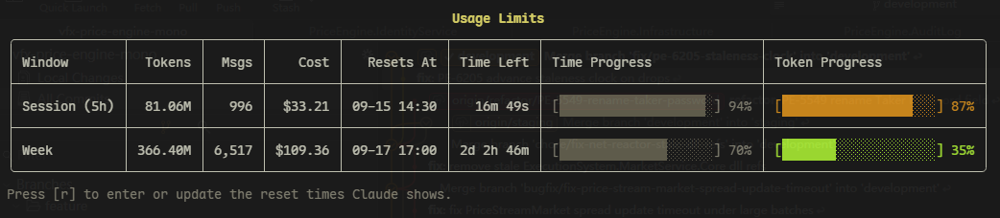

# AIUsageMonitor

[](https://github.com/coldhighsun/AIUsageMonitor/actions/workflows/ci.yml)
[](https://codecov.io/gh/coldhighsun/AIUsageMonitor)
[](https://dotnet.microsoft.com/)
[](#專案結構)
[](LICENSE)
[](https://github.com/coldhighsun/AIUsageMonitor/releases/latest)
[](https://github.com/coldhighsun/AIUsageMonitor/releases)
[](https://www.nuget.org/packages/AIUsageMonitor.Cli)
[](https://www.nuget.org/packages/AIUsageMonitor.Cli/absoluteLatest)
[](https://www.nuget.org/packages/AIUsageMonitor.Cli)
[](https://github.com/coldhighsun/AIUsageMonitor/commits/main)

[English](README.md) | [简体中文](README.zh-CN.md) | 繁體中文

---

一個基於 Claude Code 本機使用資料的**唯讀**分析工具。它從不呼叫 Anthropic API，只讀取 Claude Code 自身已經寫入 `~/.claude` 目錄下的檔案(`stats-cache.json`、`history.jsonl`、`projects/*.jsonl` 工作階段記錄),並將其轉換為依日/依週期/依模型/依小時/依工作階段的用量報表與成本估算。

## 專案結構

- **AIUsageMonitor.Core** — 資料解析與分析引擎所在的類別庫，不依賴 Cli/WPF。
- **AIUsageMonitor.Cli** — 主控台程式(命令名稱 `aimon`),以命令列方式輸出用量報表。
- **AIUsageMonitor.WPF** — Windows 桌面儀表板(WPF，僅支援 Windows)。

## 安裝

透過 [winget](https://learn.microsoft.com/en-us/windows/package-manager/winget/) 安裝:

```
winget install coldhighsun.AIUsageMonitor.Cli
```

或透過 [dotnet tool](https://learn.microsoft.com/en-us/dotnet/core/tools/global-tools-how-to-use) 安裝(跨平台):

```
dotnet tool install --global AIUsageMonitor.Cli
```

或從原始碼建置:

```
dotnet build AIUsageMonitor.slnx
```

## CLI 用法

```
aimon <命令>
```

(或從原始碼執行:`dotnet run --project src/AIUsageMonitor.Cli -- <命令>`)

> 💡 **優先使用 `aimon watch`** —— 這是日常使用本工具的建議方式:即時顯示目前工作階段和每週額度的用量情況，讓你隨時掌握剩餘空間。

可用命令:

- `watch` — **(建議)** 即時更新檢視(`limits|today|week|models|sessions|hours`，預設為 `limits`)，依指定間隔自動更新
- `today` — 今日用量
- `week` — 本週用量
- `month` — 本月用量
- `models` — 依模型統計用量
- `sessions` — 工作階段整體統計;加上 `--list` 則列出每個工作階段
- `projects` — 依專案統計用量
- `hours` — 依小時統計用量
- `export` — 匯出原始分析資料;支援 `--format json|csv` 與 `--output <path>`(預設輸出到標準輸出，格式為 JSON)

報表選項(`today`、`week`、`month`、`models`、`hours`、`sessions`):

- `--json` — 以 JSON 輸出(不顯示進度列和表格，並略過更新檢查)，方便指令碼處理
- `today --date yyyy-MM-dd` — 檢視指定的某一天
- `week` / `month`:`--from yyyy-MM-dd [--to yyyy-MM-dd]` 或 `--last <天數>`;`month` 另支援 `--month yyyy-MM`。範圍最長 3650 天，年份限定在 2000–2999;值無效時會向 stderr 輸出錯誤並以結束代碼 1 結束
- `models --model <文字>` — 只顯示名稱包含該文字的模型(占比仍相對於全部模型)。若沒有符合項目，表格模式會向 stderr 輸出 `No model matches '<文字>'.` 並以結束代碼 0 結束，`--json` 則輸出 `[]`

依專案、依工作階段統計(`projects`、`sessions --list`):

- 範圍:`--from`/`--to`、`--last`、`--month` 同上，預設為**最近 30 天**
- `--top <n>` — 只顯示前 N 列;`--sort` — `projects`:`tokens|cost|sessions|messages`，`sessions --list`:`tokens|cost|messages|duration|start`(由大到小，`start` 為最新在前，預設 `tokens`);依 `messages` 排序時表格會增加 Messages 欄
- `--project <文字>` — 只看工作目錄或 `projects/` 資料夾名稱包含該文字的專案;`--model <文字>` — 只統計名稱符合的模型(工作階段中只計入這些助理訊息)
- `--json` 會輸出 `totalProjects` / `totalSessions`(套用 `--top` 之前的符合數)和各列資料，時長欄位為 `durationSeconds`
- 不帶 `--list` 的 `sessions` 行為不變;不帶 `--list` 卻給了範圍、`--top`、`--sort`、`--project` 或 `--model` 會報錯
- 工作階段會被範圍裁剪(只顯示範圍內發生的部分)，可能跨多個轉錄檔;`messages` 統計轉錄行數，`duration` 是首尾訊息之間的實際經過時間(含閒置)。同一天範圍內 token 與 `month` 一致;這裡的費用依每則訊息精確計價(含 5 分鐘/1 小時快取寫入)，所以和 `month`(依全期模型比例縮放估算)略有出入，且 `month` 會把跨日工作階段在每個活躍日各算一次

`watch` 的預設檢視 `limits` 近似呈現 Claude 官方帳戶介面中的 "Current Session"(滾動 5 小時視窗)和 "This Week" 面板，各自附帶 **Time Progress**(視窗已經過的時間比例，當 token 消耗明顯落後/領先於時間進度時會分別顯示綠色/橘色)與 **Token Progress**(用量占預算的比例)兩條進度列。針對目前工作階段視窗，當 token 消耗進度明顯快於或慢於時間進度時，表格下方還會出現一則節奏提示，建議你放慢或可以放心多用。

真實的重置時間和 token 上限儲存在 Anthropic 帳號端，本機無法讀取，建議各輸入一次:

- `--session-reset "HH:mm"` — Claude 顯示的工作階段重置時間(如 `"18:30"`)
- `--week-reset "Ddd HH:mm"` — 每週重置時刻(如 `"Mon 09:00"`);帳號固定不變，只需輸入一次，不會像工作階段那樣過期
- `--session-token-progress <百分比>` / `--week-token-progress <百分比>` — Claude 顯示的用量百分比(如 `32`)，用來反推出用量預算。百分比會連同當時統計到的成本一起儲存，預算由它推算;視窗內還沒有統計到用量時給出的百分比會被忽略(保留已儲存的)
- `--cache-read-weight <0-1>` — cache read token 依定價的多大比例計入用量進度列(預設 `0.1`，為經驗值:訂閱額度不依 API 定價計量，而 cache read 在長工作階段中占絕大多數)。進度列比 Claude 顯示的快就調小，慢就調大;已儲存的百分比會保留並依新權重重新推算預算，無需再查看 `/usage`。傳入後會被儲存，`--reset-cache-read-weight` 可清除它。表格下方有一行說明進度列由哪幾類 token 組成(cache read / output / cache write / input)

不設定這些參數時，會根據本機工作階段記錄估算;當本機證據不足時(近 5 小時無活動，或根本沒有週期錨點)，對應列會顯示為**未知**，而不是編造一個倒數計時。

在 `watch` 執行中按 `r` 可隨時重新輸入以上四項(直接按 Enter 保留目前值)。在互動式終端機中，未設定的項目會一次性提示輸入，並儲存到 `%LOCALAPPDATA%/aimon/limits-settings.json`(或對應系統的等效路徑)供後續執行重複使用。



## 更新檢查

每個命令執行結束後都會檢查一次 GitHub 上是否有新版本發行(`watch` 會在進入更新迴圈前檢查一次，並在整個執行期間將提示固定顯示在檢視底部)。帶 `--json` 的呼叫會完全略過該檢查，因此指令碼呼叫不會發出網路請求，也不會為此等待;提示本身輸出到 stderr。如果有新版本，會列印一行提示，附帶新版本號和發行頁連結——這不會阻塞或影響命令本身的執行，除了標準的 GitHub 最新發行查詢請求外不會傳送任何其他資料。

## WPF 儀表板(僅限 Windows)

> **⚠️ 尚在開發中，暫不建議使用。** WPF 專案目前仍在積極開發，功能不完整，可能存在明顯問題。請先使用 CLI(`aimon`)。

```
dotnet run --project src/AIUsageMonitor.WPF
```

每分鐘輪詢一次用量資料，並繪製依日/依模型/依小時的圖表。

## 已知限制

⚠️ **多裝置使用**: 如果你在同一個計費週期內(工作階段視窗或週期)於多部裝置上使用 Claude Code，本工具的統計資料和進度列可能不準確。因為本工具只能讀取本機資料檔案(`~/.claude` 目錄下的 `stats-cache.json`、`history.jsonl` 和工作階段記錄)，無法看到其他裝置上的用量。為了確保跨裝置的計數準確，建議手動設定 `--session-token-progress` 和 `--week-token-progress`，填入 Anthropic 官方帳戶介面顯示的用量百分比，這樣工具就能推算出真實的 token 預算上限。

## 運作原理

各資料來源專屬的解析程式碼位於 `Providers/<名稱>/` 下(如 `Providers/Claude/`)，結果匯入 `Analytics/UsageAnalyzer`，再透過 `Services/DataService` 統一供 CLI 與 WPF 兩端使用。完整的資料流細節請見 [CLAUDE.md](CLAUDE.md)。

## 發行

推送 `v*` 標籤會為 win-x64/linux-x64/osx-x64/osx-arm64 建置自包含的 CLI 二進位檔，附加到 GitHub Release，並將 `aimon` dotnet 工具發行到 NuGet(詳見 `.github/workflows/ci.yml`)。

## 授權條款

MIT — 詳見 [LICENSE](LICENSE)。
